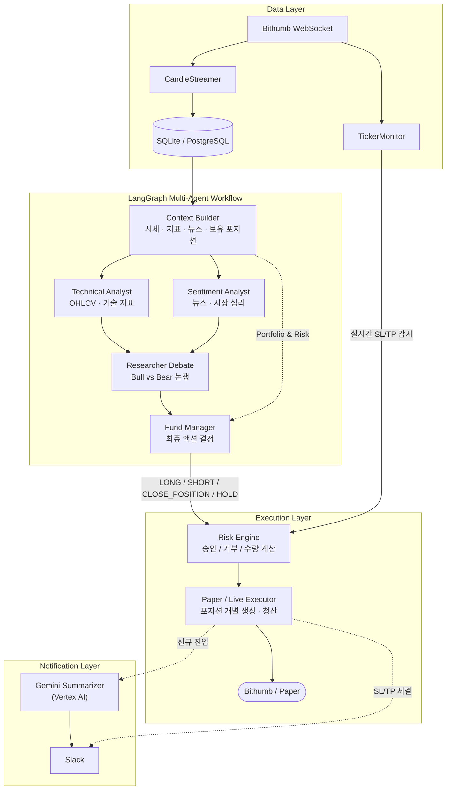

# OpenTrading

[English](README.md) | **한국어**

LangGraph 멀티 에이전트가 시세·기술 지표·뉴스를 종합해 LONG / SHORT / CLOSE_POSITION / HOLD를 결정하는 암호화폐 자동 트레이딩 시스템입니다. 모든 결정은 리스크 엔진 검증을 거친 뒤 실행되며, 여러 포지션을 동시에 운용할 수 있습니다.

> 기본값은 모의 투자(paper) 모드입니다. 실주문은 `TRADING_MODE=live`와 `LIVE_TRADING_ENABLED=true`가 모두 필요합니다. 투자 조언이 아닙니다.

## 핵심 특징

- **멀티 에이전트 결정**: 기술 분석가와 심리 분석가가 병렬로 분석하고, Bull vs Bear 토론을 거쳐 펀드 매니저가 최종 결정합니다.
- **코드로 구현한 리스크 엔진**: 레버리지 한도, 낙폭 킬 스위치, 재진입 쿨다운, confidence 하한, 리스크 예산 기반 수량 계산.
- **멀티 포지션**: 기존 포지션을 건드리지 않고 새 포지션을 추가하고, `position_id`로 특정 포지션만 청산합니다.
- **실시간 SL/TP**: WebSocket 티커 모니터가 손절·익절가 도달 즉시 청산하며, 트레일링 스탑과 트레일링 TP를 지원합니다.
- **관측성**: [Opik](https://www.comet.com/opik)으로 노드별 지연·입출력·토큰 사용량을 추적(선택)하고 Slack으로 알림을 보냅니다.

## 아키텍처



## 빠른 시작

Python 3.12 이상과 [uv](https://docs.astral.sh/uv/)가 필요합니다.

```bash
uv sync
cp .env.example .env              # LLM provider와 API 키 입력
uv run coin-trading init-db       # 테이블 생성 (최초 1회)
uv run coin-trading run-once      # 데이터 수집 + LLM 결정 1회
uv run streamlit run src/coin_trading/dashboard.py
```

기본 `DATABASE_URL`은 로컬 SQLite 파일입니다. `docker-compose.yml`에 PostgreSQL, worker, dashboard 서비스가 있습니다.

## CLI

| 명령어 | 설명 |
|---|---|
| `init-db` | DB 테이블 생성. `--reset`으로 데이터 초기화 |
| `serve-all` | 실시간 WebSocket + 스케줄 결정 루프 + 헬스체크 (운영용) |
| `refresh-data` | 시세·지표 수집만 실행 |
| `decide-once` | 수집 없이 DB 데이터로 LLM 결정 1회 |
| `run-once` | `refresh-data` 후 `decide-once` 실행 |

모두 `uv run coin-trading <명령어>` 형태로 실행합니다.

## 결정 기준

**신규 진입**

| 액션 | 조건 |
|---|---|
| LONG | 추세 상승 · RSI 30–65 · 리스크/보상 ≥ 2:1 · 소프트 시그널 1개 이상 |
| SHORT | 추세 하락 · RSI 35–70 · 리스크/보상 ≥ 2:1 · 소프트 시그널 1개 이상 |
| HOLD | 시그널 불분명 · confidence < 0.50 · 데이터 부족 |

소프트 시그널: 모멘텀(RSI·MACD 방향), 거래량(`volume_ratio` ≥ 0.40), 논쟁 결과(Bull/Bear WEAK 이상) 중 하나.

**SL/TP 최소 거리 (모든 provider에 코드로 강제)**

| | 최소값 |
|---|---|
| SL 거리 | `max(1.5 × ATR, entry × 0.3%)` |
| TP 거리 | `max(3.0 × ATR, entry × 0.6%)` |
| Risk/Reward | 2:1 이상 |

**confidence별 포지션 비중**

| confidence | 최대 투입 비중 |
|---|---|
| < 0.60 | `MAX_POSITION_ALLOCATION_PCT`의 50% |
| 0.60 – 0.75 | `MAX_POSITION_ALLOCATION_PCT`의 75% |
| ≥ 0.75 | `MAX_POSITION_ALLOCATION_PCT`까지 |

TP 도달, 추세 반전, SL까지 ATR × 0.3 이내, 8–10시간 경과 후 진전 없음이면 청산을 권고합니다.

## 리스크 엔진

```
신호 수신
  ├─ HOLD            → 주문 없음
  ├─ CLOSE_POSITION  → position_id 확인 → 청산
  └─ LONG / SHORT
       ├─ leverage > MAX_LEVERAGE                → 거부
       ├─ 낙폭 > KILL_SWITCH_DRAWDOWN            → 거부 (킬 스위치)
       ├─ 재진입 쿨다운 미경과                    → 거부
       ├─ confidence < 0.50                      → 거부
       └─ 승인 → 수량 계산 → 실행
```

```
risk_budget    = current_equity × RISK_PER_TRADE
raw_quantity   = risk_budget / |entry_price - stop_loss|
allocation_pct = min(LLM 제안값, MAX_POSITION_ALLOCATION_PCT)
max_notional   = current_equity × allocation_pct × leverage
final_quantity = min(raw_quantity, max_notional / entry_price)
```

| 메커니즘 | 동작 | 환경변수 |
|---|---|---|
| 트레일링 스탑 | 현재가에서 일정 % 뒤로 SL이 따라감 | `TRAILING_STOP_PCT` |
| 트레일링 TP (Comeback) | 가격이 TP를 돌파하면 기존 TP를 trigger로 저장하고 TP를 연장. 가격이 trigger로 돌아오면 청산 | `TRAILING_TP_PCT` |
| TP 근접 시 SL 조임 | TP에서 1.5 × ATR 이내면 SL을 entry 쪽으로 0.5 × ATR씩 당김 | 자동 |

| 안전 설정 | 기본값 | 설명 |
|---|---|---|
| `RISK_PER_TRADE` | 5% | 한 거래가 손절될 때 잃는 최대 자산 비율 |
| `MAX_POSITION_ALLOCATION_PCT` | 20% | 단일 포지션 최대 투입 비율 |
| `KILL_SWITCH_DRAWDOWN` | 10% | 이 낙폭을 넘으면 신규 진입 전면 차단 |
| `LIQUIDATION_BUFFER` | 8% | 청산가 8% 이내 접근 시 경고 이벤트 |
| `PRICE_CONSISTENCY_THRESHOLD_PCT` | 0.5% | LLM 결정 중 가격이 이만큼 넘게 움직이면 주문 취소 |
| `TRADING_MODE` | `paper` | 실주문은 `live`와 `LIVE_TRADING_ENABLED=true` 동시 필요 |

## 뉴스

CoinDesk Data API(기본) 또는 RSS에서 뉴스를 수집해 심리 분석가가 사용합니다. CoinDesk가 붙인 `SENTIMENT` 라벨(`POSITIVE` / `NEUTRAL` / `NEGATIVE`)을 그대로 LLM에 전달합니다. high watermark(`AppState.coindesk_last_published_ts`)로 사이클마다 새 기사만 적재합니다.

```env
NEWS_SOURCE=coindesk         # coindesk | rss
COINDESK_API_KEY=...
COINDESK_CATEGORIES=BTC      # 빈 값이면 전체
COINDESK_FETCH_LIMIT=50
```

## 관측성과 알림

- **Opik**: `OPIK_API_KEY`, `OPIK_WORKSPACE`, `OPIK_PROJECT_NAME`을 설정하면 노드별로 트레이싱합니다. 미설정이면 꺼지며 거래에는 영향이 없습니다. 노드별 소요 시간은 stdout과 `logs/trading.log`에도 남습니다.
- **Slack** (`SLACK_WEBHOOK_URL`): 신규 진입(Vertex AI Gemini 요약, 미설정 시 기본 포맷), SL/TP 체결, 08:00 / 15:00 / 21:00 헬스체크.

## 설정

전체 항목은 `.env.example`을 참고하세요. 주요 항목:

```env
TRADING_MODE=paper           # paper | live
EXCHANGE=bithumb_spot
SYMBOL=KRW-BTC

RISK_PER_TRADE=0.05
MAX_LEVERAGE=1
MAX_POSITION_ALLOCATION_PCT=20
KILL_SWITCH_DRAWDOWN=0.10

LLM_PROVIDER=openrouter      # mock | openai | gemini | openrouter | nvidia | vertex
LLM_MODEL=google/gemma-4-31b-it:free
```

분석가·리서처 에이전트는 `ANALYST_LLM_*`, `RESEARCHER_LLM_*`로 다른 모델을 쓸 수 있습니다. `LLM_PROVIDER`를 지정하지 않으면 `mock` provider가 사용됩니다.

## 서비스로 실행 (macOS)

`scripts/bot.sh`가 launchd 등록을 처리합니다.

```bash
./scripts/bot.sh start      # 시작 + 부팅 시 자동 시작 + 비정상 종료 시 재시작
./scripts/bot.sh stop       # 정지 + 등록 해제
./scripts/bot.sh status     # PID, 메모리, CPU
./scripts/bot.sh logs       # 트레이딩 로그 실시간 보기
./scripts/bot.sh errors     # 에러 로그 마지막 50줄
```

로그는 `logs/trading.log`에 매일 분할되어 7일치 보관됩니다.

## 프로젝트 구조

```
src/coin_trading/
├── agent/          LangGraph 에이전트 (분석가, 리서처, 펀드 매니저), 프롬프트, 스키마
├── db/             SQLAlchemy 모델 / 세션
├── market/         시세 수집, 지표, 뉴스, Bithumb REST/WebSocket
├── trade/          리스크 엔진, 포트폴리오, paper/live 실행기
├── notifications/  Slack, Gemini 요약
├── app.py          CLI 엔트리
├── config.py       Pydantic Settings
├── dashboard.py    Streamlit 대시보드
└── scheduler.py    파이프라인 / serve-all 루프
```

## 테스트

```bash
uv run pytest
```
