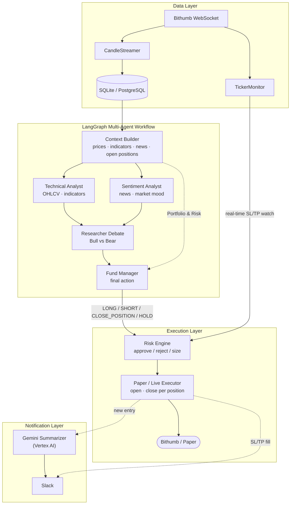

# OpenTrading

**English** | [한국어](README.ko.md)

An automated crypto trading system where LangGraph multi-agents read market data, technical indicators, and news to decide LONG / SHORT / CLOSE_POSITION / HOLD. A risk engine checks every decision before it runs, and several positions can be open at the same time.

> Runs in paper trading mode by default. Live orders need both `TRADING_MODE=live` and `LIVE_TRADING_ENABLED=true`. This is not investment advice.

## Highlights

- **Multi-agent decisions**: Technical analyst and sentiment analyst run in parallel, a Bull vs Bear debate follows, and a fund manager makes the final call.
- **Risk engine in code**: Leverage limit, drawdown kill switch, re-entry cooldown, confidence threshold, and position sizing from risk budget.
- **Multi-position**: Opens new positions without touching existing ones, and closes a specific one by `position_id`.
- **Real-time SL/TP**: A WebSocket ticker monitor closes positions the moment stop-loss or take-profit is hit, with trailing stop and trailing TP.
- **Observability**: Per-node latency, I/O, and token usage traced in [Opik](https://www.comet.com/opik) (optional), plus Slack alerts.

## Architecture



## Quick Start

Requires Python 3.12+ and [uv](https://docs.astral.sh/uv/).

```bash
uv sync
cp .env.example .env              # set LLM provider and API keys
uv run coin-trading init-db       # create tables (first time only)
uv run coin-trading run-once      # collect data + one LLM decision
uv run streamlit run src/coin_trading/dashboard.py
```

The default `DATABASE_URL` is a local SQLite file. `docker-compose.yml` provides PostgreSQL, worker, and dashboard services.

## CLI

| Command | Description |
|---|---|
| `init-db` | Create DB tables. `--reset` clears data |
| `serve-all` | Real-time WebSocket + scheduled decision loop + health check (production) |
| `refresh-data` | Collect prices and indicators only |
| `decide-once` | One LLM decision from data already in the DB |
| `run-once` | `refresh-data` then `decide-once` |

Run each as `uv run coin-trading <command>`.

## Decision Rules

**Entry**

| Action | Condition |
|---|---|
| LONG | Uptrend · RSI 30–65 · risk/reward ≥ 2:1 · at least one soft signal |
| SHORT | Downtrend · RSI 35–70 · risk/reward ≥ 2:1 · at least one soft signal |
| HOLD | Unclear signal · confidence < 0.50 · not enough data |

Soft signals: momentum (RSI/MACD direction), volume (`volume_ratio` ≥ 0.40), or debate result (Bull/Bear WEAK or stronger).

**Minimum SL/TP distance (enforced in code for every provider)**

| | Minimum |
|---|---|
| SL distance | `max(1.5 × ATR, entry × 0.3%)` |
| TP distance | `max(3.0 × ATR, entry × 0.6%)` |
| Risk/Reward | 2:1 or more |

**Position size by confidence**

| confidence | Max allocation |
|---|---|
| < 0.60 | 50% of `MAX_POSITION_ALLOCATION_PCT` |
| 0.60 – 0.75 | 75% of `MAX_POSITION_ALLOCATION_PCT` |
| ≥ 0.75 | Up to `MAX_POSITION_ALLOCATION_PCT` |

Close is suggested when TP is reached, the trend reverses, price is within 0.3 × ATR of SL, or there is no progress after 8–10 hours.

## Risk Engine

```
signal
  ├─ HOLD            → no order
  ├─ CLOSE_POSITION  → validate position_id → close
  └─ LONG / SHORT
       ├─ leverage > MAX_LEVERAGE                → reject
       ├─ drawdown > KILL_SWITCH_DRAWDOWN        → reject (kill switch)
       ├─ re-entry cooldown not over             → reject
       ├─ confidence < 0.50                      → reject
       └─ approve → size the order → execute
```

```
risk_budget    = current_equity × RISK_PER_TRADE
raw_quantity   = risk_budget / |entry_price - stop_loss|
allocation_pct = min(LLM suggestion, MAX_POSITION_ALLOCATION_PCT)
max_notional   = current_equity × allocation_pct × leverage
final_quantity = min(raw_quantity, max_notional / entry_price)
```

| Mechanism | Behavior | Env var |
|---|---|---|
| Trailing stop | SL follows the price by a fixed % | `TRAILING_STOP_PCT` |
| Trailing TP (comeback) | When price breaks TP, the old TP becomes a trigger and TP extends. Closes if price falls back to the trigger | `TRAILING_TP_PCT` |
| Tighten SL near TP | Within 1.5 × ATR of TP, SL moves 0.5 × ATR toward entry | automatic |

| Safety setting | Default | Description |
|---|---|---|
| `RISK_PER_TRADE` | 5% | Max equity lost if one trade hits SL |
| `MAX_POSITION_ALLOCATION_PCT` | 20% | Max equity in one position |
| `KILL_SWITCH_DRAWDOWN` | 10% | Blocks all new entries above this drawdown |
| `LIQUIDATION_BUFFER` | 8% | Warning event within 8% of liquidation price |
| `PRICE_CONSISTENCY_THRESHOLD_PCT` | 0.5% | Cancels the order if price moves more than this during the LLM decision |
| `TRADING_MODE` | `paper` | Live orders need `live` and `LIVE_TRADING_ENABLED=true` |

## News

News comes from the CoinDesk Data API (default) or RSS feeds and is used by the sentiment analyst. CoinDesk's own `SENTIMENT` label (`POSITIVE` / `NEUTRAL` / `NEGATIVE`) is passed to the LLM as is. A high watermark (`AppState.coindesk_last_published_ts`) makes each cycle insert only new articles.

```env
NEWS_SOURCE=coindesk         # coindesk | rss
COINDESK_API_KEY=...
COINDESK_CATEGORIES=BTC      # empty = all
COINDESK_FETCH_LIMIT=50
```

## Observability and Alerts

- **Opik**: Set `OPIK_API_KEY`, `OPIK_WORKSPACE`, and `OPIK_PROJECT_NAME` to trace each node. Unset means tracing is off and trading is not affected. Node timings are also written to stdout and `logs/trading.log`.
- **Slack** (`SLACK_WEBHOOK_URL`): new entries (summarized by Gemini on Vertex AI, with a plain fallback), SL/TP fills, and health checks at 08:00 / 15:00 / 21:00.

## Configuration

See `.env.example` for all options. Main ones:

```env
TRADING_MODE=paper           # paper | live
EXCHANGE=bithumb_spot
SYMBOL=KRW-BTC

RISK_PER_TRADE=0.05
MAX_LEVERAGE=1
MAX_POSITION_ALLOCATION_PCT=20
KILL_SWITCH_DRAWDOWN=0.10

LLM_PROVIDER=openrouter      # mock | openai | gemini | openrouter | nvidia | vertex
LLM_MODEL=google/gemma-4-31b-it:free
```

Analyst and researcher agents can use a different model with `ANALYST_LLM_*` and `RESEARCHER_LLM_*`. Without `LLM_PROVIDER`, the `mock` provider is used.

## Running as a Service (macOS)

`scripts/bot.sh` registers the bot with launchd.

```bash
./scripts/bot.sh start      # start, auto-start on boot, auto-restart on crash
./scripts/bot.sh stop       # stop and unregister
./scripts/bot.sh status     # PID, memory, CPU
./scripts/bot.sh logs       # follow trading log
./scripts/bot.sh errors     # last 50 error lines
```

Logs rotate daily in `logs/trading.log` and are kept for 7 days.

## Project Structure

```
src/coin_trading/
├── agent/          LangGraph agents (analysts, researchers, fund manager), prompts, schemas
├── db/             SQLAlchemy models and session
├── market/         Price collection, indicators, news, Bithumb REST/WebSocket
├── trade/          Risk engine, portfolio, paper/live executors
├── notifications/  Slack, Gemini summarizer
├── app.py          CLI entry point
├── config.py       Pydantic settings
├── dashboard.py    Streamlit dashboard
└── scheduler.py    Pipeline and serve-all loop
```

## Tests

```bash
uv run pytest
```
